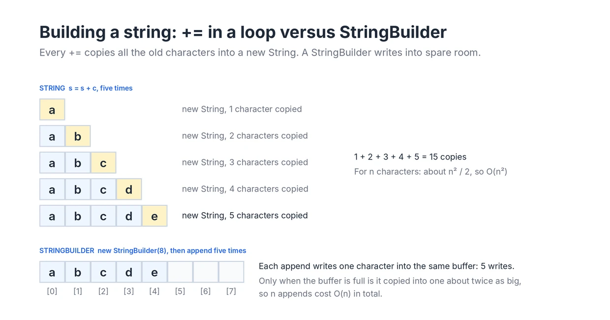

# String

**Roadmap:** Stage 1: Foundations in the [learning roadmap](../../ROADMAP.md).

## What is it?

A string is a sequence of characters, such as a word, a sentence or a line of input. In Java, text is stored in objects of the class `String`, and a single character is a `char`.

You can think of a string as a read-only array of characters. Each character has an index starting at 0, `s.charAt(i)` reads the character at index `i`, and `s.length()` gives the number of characters. Most of what you learned in the [Array guide](../01-Array/README.md) about indices, bounds and scanning applies directly.

The big difference is that a Java `String` is immutable. Once it is created, its characters can never change. Methods that look like they modify a string, such as `toUpperCase`, `replace` or `trim`, return the result as another string and leave the original untouched.

## Why does it exist?

Text is everywhere: names, words, file contents, user input, identifiers. Programs need a standard way to store it, compare it, search it and build it.

Java made `String` immutable on purpose, and that choice brings several benefits:

- A string can be shared freely. Many variables, threads or data structures can point to the same string without any risk that one of them changes it for the others.
- A string is a safe key for a `HashMap` or `HashSet`. Its hash code can never change after it is inserted, so it can always be found again. Java even caches the hash code inside the string after computing it once. See the [Hashing guide](../03-Hashing/README.md).
- String literals can be reused. Java keeps one shared copy of each literal such as `"hello"` in a pool, so identical literals do not waste memory.

The price of immutability is that building a string piece by piece creates many temporary strings. Java provides `StringBuilder` for that job: a mutable sequence of characters that you can append to, insert into, reverse and finally turn into a `String`.

## How does it work?

Internally, a `String` holds an array of characters. On Java 8 this is a `char[]`. Since Java 9, it is a `byte[]` plus a flag: text that contains only Latin-1 characters uses one byte per character, and other text uses two. This is called compact strings. It saves memory but does not change how you use strings or the complexity of their operations.

Because the characters sit in an array, `charAt(i)` and `length()` are O(1). Anything that has to look at every character, such as `equals`, `compareTo`, `indexOf`, `contains` or `toCharArray`, is O(n).

Since a string cannot change, every "modification" copies characters into a new string:

- `s.substring(i, j)` copies the `j - i` characters it returns.
- `s + t` and `s.concat(t)` copy both strings into a new one.
- `s.toUpperCase()` and `s.replace(a, b)` produce a new string of about the same length whenever anything actually changes.

`StringBuilder` avoids these copies by keeping a buffer with spare room at the end. `append` writes into the spare room. When the buffer is full, it is copied once into a new buffer roughly twice as large. This is the same growth strategy as `ArrayList`, so a long series of appends costs amortized O(1) per character. `insert` and `deleteCharAt` at the front still shift every later character, just like inserting into an array, so they are O(n).

A few details about characters matter often in problems:

- A `char` is a 16-bit number. Arithmetic on characters works on those numbers, so `c - 'a'` turns the letters `'a'` to `'z'` into the indices 0 to 25. This is the basis of the `int[26]` count table.
- `'a' + 1` is the `int` 98, not the character `'b'`. Cast back with `(char) ('a' + 1)` when you want a character.
- `Character.isLetter`, `isDigit`, `isLetterOrDigit`, `toLowerCase` and `toUpperCase` handle the common checks without hand-written ranges.
- A `char` holds one UTF-16 code unit, not always one visible character. Characters outside the basic range, such as most emoji, take two `char` values called a surrogate pair. Most interview problems restrict input to ASCII letters and digits, so this rarely matters, but `codePointCount` and `codePoints()` exist for real text.

## Visual explanation



The top half builds `"abcde"` with `s = s + c`. Each step creates a brand new string and copies every earlier character into it, so the five steps copy 1 + 2 + 3 + 4 + 5 = 15 characters. For a string of length `n`, the total is about n² / 2, which makes the loop O(n²). With 100,000 characters that is around five billion copies.

The bottom half builds the same text with a `StringBuilder` created with room for 8 characters. Each `append` writes one character into the existing buffer, so five appends cost five writes. Only when the buffer fills up is it copied into a larger one, and because it roughly doubles each time, those copies add up to O(n) over the whole loop.

## Operations and complexity

`n` is the length of the string, `m` is the length of a second string or pattern, and `k` is the length of the result.

| Operation | Time | Extra space | Notes |
|---|---|---|---|
| `s.length()`, `s.charAt(i)` | O(1) | O(1) | Direct array access |
| `s.equals(t)`, `s.compareTo(t)` | O(min(n, m)) | O(1) | Stops at the first difference. `equals` returns early when the lengths differ |
| `s.hashCode()` | O(n) the first time | O(1) | The result is cached inside the string |
| `s.indexOf(t)`, `s.contains(t)` | O(n × m) worst case | O(1) | A simple scan. It is usually much faster on ordinary text |
| `s.substring(i, j)` | O(k) | O(k) | Copies the `k = j - i` characters |
| `s + t`, `s.concat(t)` | O(n + m) | O(n + m) | Always creates a new string |
| `s += c` repeated `n` times | O(n²) total | O(n) at the end | Every step copies the whole string so far |
| `sb.append(x)` | Amortized O(1) per character | Amortized O(1) | Occasional O(n) resize |
| `sb.insert(0, x)`, `sb.deleteCharAt(0)` | O(n) | O(1) | Shifts every later character |
| `sb.reverse()`, `sb.toString()` | O(n) | O(1) and O(n) | `toString` copies the buffer into a new `String` |
| `s.toCharArray()`, `new String(chars)` | O(n) | O(n) | Each makes a full copy |
| `s.split(regex)` | O(n) for simple patterns | O(n) | Uses regular expressions, so it is slower than a manual scan |
| Sort the characters | O(n log n) | O(n) | `toCharArray`, then `Arrays.sort` |

## When should I use it?

Use `String` for any text the problem gives you, and keep it as a `String` while you only read it with `charAt` and `length`. Typical string problems include:

- Checking a property of the text, such as whether it is a palindrome, contains only valid characters or has balanced brackets.
- Counting characters, for example to check whether two words are anagrams. An `int[26]` table works for lowercase English letters, and a `HashMap<Character, Integer>` works for anything else.
- Finding a substring that satisfies a condition, such as the longest one without repeating characters.
- Comparing or matching two strings, such as the longest common prefix or whether one is a subsequence of the other.
- Building a new string from parts, such as reversing the words in a sentence or compressing repeated characters.

Use `StringBuilder` whenever you build a string in a loop, and use a `char[]` when you need to change characters in place, swap them or sort them.

## When should I avoid it?

Avoid repeated `+=` or `substring` inside a loop over a long string. Both copy characters on every iteration and can turn an O(n) idea into an O(n²) program. Work with indices into the original string instead, and build any output with a `StringBuilder`.

Avoid a `String` when you need to modify characters in place. Convert to a `char[]`, change the array, and convert back once at the end.

Avoid `split` and regular expressions in performance-sensitive loops when a simple scan with `charAt` does the job. They are convenient for parsing input, but they allocate an array and many small strings.

When the problem is mostly about many prefix lookups over a set of words, such as autocomplete, look at the [Trie](../14-Trie/README.md) instead of comparing strings one by one.

## Java implementation

This example shows the string operations used most often in problems.

```java
import java.util.*;

public class StringBasics {
    public static void main(String[] args) {
        String s = "racecar";

        // length() and charAt(i): both O(1)
        System.out.println("length = " + s.length() + ", charAt(3) = " + s.charAt(3));

        // Strings are immutable. toUpperCase returns a new string.
        String upper = s.toUpperCase();
        System.out.println("s = " + s + ", upper = " + upper);

        // Compare contents with equals, not ==
        String built = new String("racecar");
        System.out.println("built == s: " + (built == s) + ", built.equals(s): " + built.equals(s));

        // Palindrome check with two indices moving toward each other: O(n)
        int left = 0, right = s.length() - 1;
        boolean palindrome = true;
        while (left < right) {
            if (s.charAt(left) != s.charAt(right)) {
                palindrome = false;
                break;
            }
            left++;
            right--;
        }
        System.out.println("palindrome = " + palindrome);

        // Count letters with an int[26] table. c - 'a' maps 'a'..'z' to 0..25.
        int[] counts = new int[26];
        for (int i = 0; i < s.length(); i++) {
            counts[s.charAt(i) - 'a']++;
        }
        System.out.println("count of r = " + counts['r' - 'a'] + ", count of e = " + counts['e' - 'a']);

        // Anagram check: sort the characters of both words and compare
        char[] a = "listen".toCharArray();
        char[] b = "silent".toCharArray();
        Arrays.sort(a);
        Arrays.sort(b);
        System.out.println("sorted listen = " + new String(a) + ", anagram = " + Arrays.equals(a, b));

        // Build a string with StringBuilder: amortized O(1) per append
        StringBuilder sb = new StringBuilder();
        for (char c = 'a'; c <= 'e'; c++) {
            sb.append(c).append(',');
        }
        sb.setLength(sb.length() - 1); // remove the last comma
        System.out.println("built = " + sb + ", reversed = " + new StringBuilder("abcde").reverse());

        // substring(begin, end) includes begin and excludes end
        System.out.println("substring(1, 4) = " + s.substring(1, 4));

        // char arithmetic gives an int unless you cast back to char
        System.out.println("'a' + 1 = " + ('a' + 1) + ", (char) ('a' + 1) = " + (char) ('a' + 1));

        // One emoji is two char values (a surrogate pair) but one code point
        String smile = "\uD83D\uDE00";
        System.out.println("emoji length = " + smile.length() + ", code points = " + smile.codePointCount(0, smile.length()));
    }
}
```

Output:

```
length = 7, charAt(3) = e
s = racecar, upper = RACECAR
built == s: false, built.equals(s): true
palindrome = true
count of r = 2, count of e = 1
sorted listen = eilnst, anagram = true
built = a,b,c,d,e, reversed = edcba
substring(1, 4) = ace
'a' + 1 = 98, (char) ('a' + 1) = b
emoji length = 2, code points = 1
```

`built == s` is `false` because `new String(...)` always creates a separate object, even though the characters are the same. `equals` compares the characters, which is almost always what you want.

## Common mistakes

- **Comparing strings with `==`.** It checks whether two variables refer to the same object. It can appear to work for literals, which share one pooled copy, and then fail for strings read from input or built at run time. Use `equals`.
- **Forgetting that strings are immutable.** `s.toUpperCase();` on its own line does nothing useful. Write `s = s.toUpperCase();`.
- **Building a string with `+=` in a loop.** Each step copies the whole string so far, giving O(n²) time. Use a `StringBuilder`.
- **Off-by-one errors with `substring`.** `substring(begin, end)` excludes `end`, and `substring(begin)` runs to the end of the string. Valid indices for `charAt` are `0` to `length() - 1`.
- **Mixing up `length()` and `length`.** Strings use the method `s.length()`, arrays use the field `arr.length`, and `StringBuilder` also uses `sb.length()`.
- **Expecting `char` arithmetic to give a `char`.** `'a' + 1` is the `int` 98, and `"" + 'a' + 1` is the string `"a1"`. Cast with `(char)` when you need a character.
- **Assuming only lowercase letters.** An `int[26]` table indexed by `c - 'a'` throws `ArrayIndexOutOfBoundsException` for an uppercase letter, digit or space. Check the constraints, and use `int[128]` for ASCII or a `HashMap` for anything wider.
- **Passing special characters to `split`.** Its argument is a regular expression, so `split(".")` and `split("|")` do not split on a dot or a bar. Use `split("\\.")` and `split("\\|")`. Also note that `split` drops trailing empty strings.
- **Treating `null` and `""` the same.** Calling a method on `null` throws `NullPointerException`, while `""` is a valid string of length 0. Write `"text".equals(s)` when `s` might be `null`.

## Related patterns

Many string problems are solved by the same patterns as array problems. Their full guides are listed in the [patterns index](../../Patterns/README.md).

- **Two Pointers** for palindromes, reversing in place, and comparing two strings character by character.
- **Sliding Window** for the longest or shortest substring that satisfies a condition, such as having no repeated characters.
- **Hashing** for anagrams, character frequencies and grouping words that share a property.
- **Dynamic Programming** for comparing two strings, such as edit distance or the longest common subsequence.

## Practice problems

### Easy

None yet.

### Medium

None yet.

### Hard

None yet.
