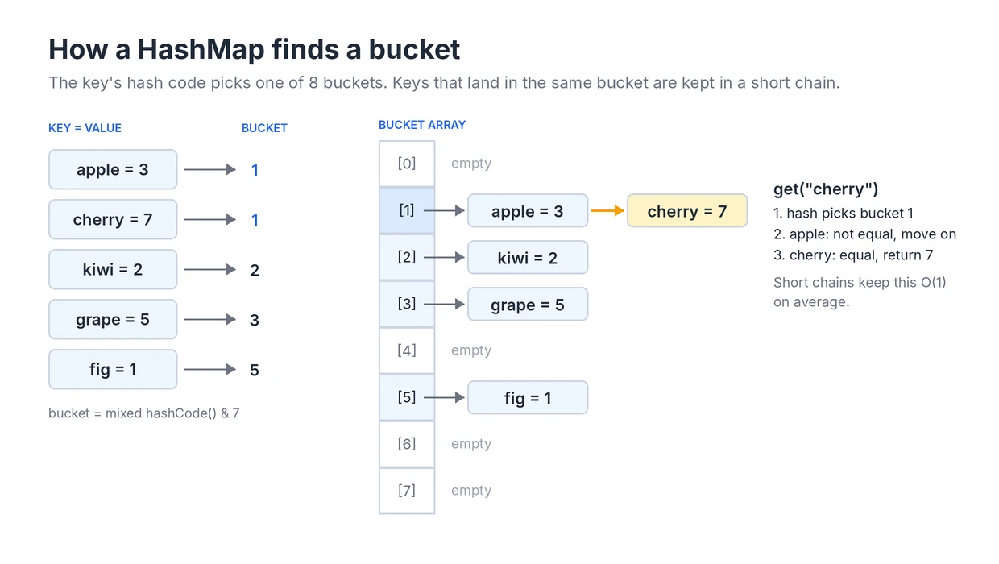

# Hashing

**Roadmap:** Stage 1: Foundations in the [learning roadmap](../../ROADMAP.md).

## What is it?

Hashing is a way of storing values so that you can find one again without searching through all of them. A hash function turns a key, such as a word or a number, into an integer called its hash code. That integer decides where in an array the entry is stored. To look the key up later, you compute the same hash code and go straight to the same place.

The data structure built on this idea is a hash table. In Java you use it through two classes:

- `HashMap<K, V>` stores key-value pairs, such as a word and how many times it appears.
- `HashSet<E>` stores only keys, and answers "have I seen this before?". Internally it is a `HashMap` whose values are ignored.

## Why does it exist?

An unsorted [array](../01-Array/README.md) can only answer "is 42 here?" by checking every element, which takes O(n) time. Sorting the array first allows binary search in O(log n), but sorting costs O(n log n) and makes inserting new values slow.

A hash table answers the same question in O(1) time on average, and it can also insert and delete in O(1) on average. It pays for this with extra memory and with losing any useful order between the keys. This trade of memory for speed is the reason hashing appears in so many solutions: a nested loop that searches for something can often become a single loop with a hash map lookup inside it.

## How does it work?

A `HashMap` keeps an internal array of buckets. Putting or getting a key goes through three steps:

1. **Compute the hash code.** Every Java object has a `hashCode()` method. For a `String`, it is calculated from the characters, so equal strings always produce the same number.
2. **Pick a bucket.** The hash code can be any `int`, so it is reduced to a bucket index. OpenJDK's `HashMap` keeps the number of buckets a power of two, mixes the high bits of the hash code into the low bits, and keeps only the low bits: `index = (h ^ (h >>> 16)) & (buckets - 1)`.
3. **Search the bucket.** Different keys can produce the same index. This is called a collision. The bucket holds a short chain of entries, and the map compares the key with each one using `equals()` until it finds a match or reaches the end.

When the map holds more entries than its capacity multiplied by the load factor (0.75 by default), it doubles the number of buckets and moves every entry into the new array. A new `HashMap` starts with 16 buckets, so it grows when the 13th entry is added. Growing costs O(n), but it happens so rarely that each insertion is still O(1) on average, in the same way as `ArrayList.add`.

Because of these steps, keys must follow the `equals` and `hashCode` contract: if two keys are equal, they must return the same hash code. `String`, `Integer` and the other standard classes already do this. If you use your own class as a key, override both methods together, or equal keys will land in different buckets and never be found.

Since Java 8, a single bucket that collects many entries (more than about 8, once the table has at least 64 buckets) is turned from a chain into a balanced tree. This limits the damage from a poor hash function or from input designed to cause collisions.

## Visual explanation



The five keys are real Java strings, and the bucket numbers are the ones a `HashMap` with 8 buckets actually computes for them. Most keys get a bucket to themselves, but `apple` and `cherry` both land in bucket 1, so they share a chain.

Follow `get("cherry")`. The hash code sends it straight to bucket 1, so buckets 0 and 2 to 7 are never looked at. Inside bucket 1 it compares with `apple`, which is not equal, and then with `cherry`, which is. The work depends on the length of one chain, not on the size of the map. As long as the hash function spreads keys evenly and the table grows in time, chains stay short and a lookup takes O(1) on average.

## Operations and complexity

`n` is the number of entries. "Average" assumes a hash function that spreads keys evenly, which is true for the standard Java classes.

| Operation | Average time | Worst time | Notes |
|---|---|---|---|
| `put(key, value)` / `add(key)` | O(1) | O(n) | Includes an occasional O(n) resize, averaged over many inserts |
| `get(key)` / `contains(key)` | O(1) | O(n) | Worst case is many keys in one bucket; tree buckets in Java 8+ reduce it to O(log n) for comparable keys |
| `remove(key)` | O(1) | O(n) | Same reasoning as `get` |
| Iterate over all entries | O(n + buckets) | O(n + buckets) | Visits every bucket, including empty ones |
| Find the smallest or largest key | O(n) | O(n) | A hash table keeps no order; use `TreeMap` for this |

The map itself takes O(n) extra space. In practice each entry is a separate object, and primitive keys and values are boxed into `Integer` or `Long` objects, so a `HashMap<Integer, Integer>` uses several times more memory than an `int[]` with the same number of values.

Hashing a key also has a cost. For a `String`, `hashCode()` reads every character the first time, so it is O(length of the key). Java caches the result inside the string, but a lookup that builds a new string each time still pays to hash it.

## When should I use it?

Reach for a hash map or hash set when the problem keeps asking a question about values rather than positions. Common clues:

- **"Have I seen this before?"** Finding duplicates, or the first repeated element. A `HashSet` turns the O(n²) check of every pair into one pass.
- **"How many times?"** Counting frequencies of numbers, characters or words. A `HashMap<value, count>` builds the whole table in one pass.
- **"Is the partner I need somewhere?"** Many pair problems ask for two values that combine into a target. Instead of searching for the partner with a second loop, store what you have seen and look the partner up directly.
- **"Group these by some property."** Words with the same letters, items with the same category. The property becomes the key, and the value is a list.
- **"Remember an answer for later."** Caching results of earlier computations, which is the idea behind memoization in dynamic programming.

These clues suggest hashing but do not guarantee it. If the input is already sorted, two pointers may do the same job with no extra memory. Always check what the problem gives you before choosing.

## When should I avoid it?

Avoid a hash table when:

- **The keys are small integers in a known range.** Counting the letters `a` to `z` or values from 0 to 1,000 is faster and lighter with a plain `int[]`, as shown in the [Array guide](../01-Array/README.md).
- **You need order.** A hash table cannot give you the smallest key, the next larger key or keys in sorted order. Use `TreeMap` or `TreeSet` (O(log n) per operation), or sort the data.
- **You need to keep insertion order when iterating.** `HashMap` iteration order is not defined and can change as the map grows. Use `LinkedHashMap` or `LinkedHashSet`.
- **Memory is tight and the input is sorted.** Two pointers or binary search often solve the same problem in O(1) extra space.
- **You need a guaranteed worst case.** Average O(1) is not a promise for every operation. When a strict bound matters, a balanced tree gives O(log n) every time.

## Java implementation

This example shows the operations used most often in problems. The `bucketIndex` method is not something you write in real code; it copies OpenJDK's bucket calculation so you can check the numbers in the diagram.

```java
import java.util.*;

public class HashingBasics {

    // Mirrors how OpenJDK's HashMap picks a bucket. Shown only to explain the diagram.
    static int bucketIndex(Object key, int bucketCount) {
        int h = key.hashCode();
        h = h ^ (h >>> 16);            // mix the high bits into the low bits
        return h & (bucketCount - 1);  // bucketCount is a power of two
    }

    public static void main(String[] args) {
        // Which bucket each key lands in, for a table of 8 buckets
        for (String fruit : new String[] {"apple", "cherry", "kiwi"}) {
            System.out.println(fruit + " -> bucket " + bucketIndex(fruit, 8));
        }

        // HashSet: is this value present? O(1) on average
        Set<Integer> seen = new HashSet<>();
        int firstRepeat = -1;
        for (int value : new int[] {4, 1, 7, 1, 4}) {
            if (!seen.add(value)) { // add returns false if the value was already there
                firstRepeat = value;
                break;
            }
        }
        System.out.println("first repeated value = " + firstRepeat);

        // HashMap: count how often each word appears
        Map<String, Integer> counts = new HashMap<>();
        for (String word : "the cat and the hat and the bat".split(" ")) {
            counts.put(word, counts.getOrDefault(word, 0) + 1);
        }
        System.out.println("count of the = " + counts.get("the"));
        System.out.println("count of dog = " + counts.getOrDefault("dog", 0));

        // HashMap iteration order is not defined. Copy into a TreeMap to print in key order.
        System.out.println("all counts = " + new TreeMap<>(counts));

        // Group words by their first letter
        Map<Character, List<String>> groups = new TreeMap<>();
        for (String word : new String[] {"bat", "ant", "bee", "ape", "cow"}) {
            groups.computeIfAbsent(word.charAt(0), k -> new ArrayList<>()).add(word);
        }
        System.out.println("groups = " + groups);
    }
}
```

Output:

```
apple -> bucket 1
cherry -> bucket 1
kiwi -> bucket 2
first repeated value = 1
count of the = 3
count of dog = 0
all counts = {and=2, bat=1, cat=1, hat=1, the=3}
groups = {a=[ant, ape], b=[bat, bee], c=[cow]}
```

`getOrDefault`, `computeIfAbsent` and `merge` were added in Java 8 and are the shortest way to write counting and grouping code. `counts.merge(word, 1, Integer::sum)` is another common way to write the counting line.

## Common mistakes

- **Comparing boxed values with `==`.** `map.get(a) == map.get(b)` compares two `Integer` objects, not two numbers. It happens to work for values from -128 to 127 because Java caches those objects, and then fails for larger values. Use `equals`, or unbox into `int` first.
- **Unboxing a missing value.** `int c = map.get(key);` throws `NullPointerException` when the key is absent, because `get` returns `null`. Use `getOrDefault(key, 0)` or check `containsKey` first.
- **Using `get(key) != null` to test for a key.** A `HashMap` may store `null` as a value, so a present key can still return `null`. Use `containsKey` when that matters.
- **Overriding `equals` without `hashCode`.** Two equal objects then usually land in different buckets, and `contains` returns `false` for a key you just added.
- **Changing a key after inserting it.** If a field used by `hashCode` changes, the entry stays in its old bucket and can no longer be found. Use immutable keys such as `String`, `Integer` or a key class with final fields.
- **Depending on iteration order.** Code that prints a `HashMap` directly, or returns "the first key" from one, may give a different order on another JVM or after more inserts.
- **Using an array as a key.** `int[]` uses identity for `equals` and `hashCode`, so two arrays with the same contents are different keys. Convert to a `String` or a `List<Integer>`, or use `Arrays.hashCode` inside your own key class.
- **Removing entries while looping with for-each.** This throws `ConcurrentModificationException`. Use the iterator's `remove` method or `map.entrySet().removeIf(...)`.

## Related patterns

Hashing is both a data structure and a pattern. The pattern guides are listed in the [patterns index](../../Patterns/README.md).

- **Hashing** for duplicates, frequency counts, complements and grouping in a single pass.
- **Prefix Sum** combined with a hash map of earlier prefix sums, to count subarrays with a given sum.
- **Sliding Window** often keeps a frequency map of the characters or values inside the window.
- **Two Pointers** is the main alternative when the input is sorted, and needs no extra memory.

## Practice problems

### Easy

None yet.

### Medium

None yet.

### Hard

None yet.
