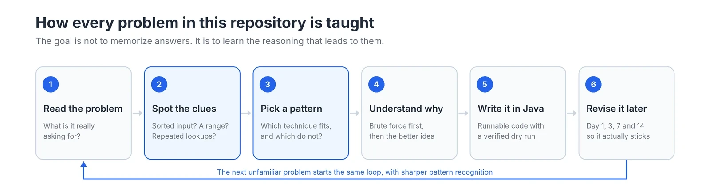
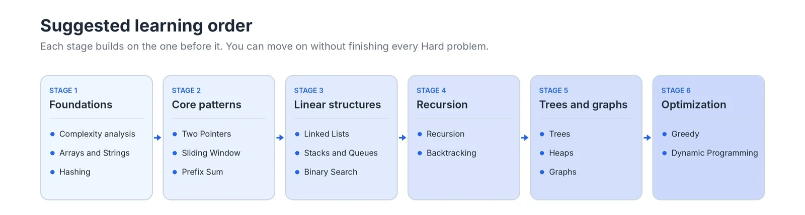

# Java DSA Mastery

A structured, open-source guide to Data Structures and Algorithms in Java, built around one skill that most solution collections skip: recognizing which pattern a problem needs before you start coding.

## Why this repository exists

Most people who study DSA hit the same wall. They solve a problem, understand the solution, and two weeks later cannot solve a slightly different version of it. The answer was remembered, but the reasoning behind it never was.

I started this repository because that was my experience too. I restarted DSA more than once, and each time the material faded because I had learned solutions instead of patterns. This project is my attempt to fix that properly, and to leave behind something that helps other developers avoid the same loop.

So this is not a dump of solved LeetCode questions. Every problem here is written to answer a harder question: how would you have known to use this approach if nobody told you?

## How each problem is taught



Every problem follows the same loop. Steps 2 and 3 are highlighted because they are the focus of this repository. Before any code appears, each problem explains what clues are present in the statement, which patterns are worth considering, and why some of them fit better than others. The revision step exists because understanding something once is not the same as being able to use it a month later.

## Who this is for

- Developers learning DSA for the first time who want explanations from first principles.
- Developers who have solved problems before but struggle with unfamiliar ones.
- Anyone preparing for software engineering interviews in Java.
- Java developers who want to see how the language has evolved from Java 8 to Java 21.

You do not need personal guidance to use this repository. Each topic and pattern guide is written to stand on its own.

## What you will find inside

| Folder | What it contains |
|---|---|
| `DSA/` | Topics such as Array, String, LinkedList, Tree and Graph. Each topic has a guide and problems grouped into Easy, Medium and Hard. |
| `Patterns/` | One guide per technique, such as Two Pointers, Sliding Window and Monotonic Stack. Each covers what it is, when to use it, why it works, and when it fails. |
| `JavaVersions/` | Notes on what changed in Java 8, 11, 17 and 21, with a compatibility matrix. |
| `assets/` | Original diagrams used across the guides. |
| `templates/` | The structure every topic, pattern and problem follows. |
| `scripts/` | Validation scripts that check naming, links and that every solution compiles and runs. |

Each problem lives in its own folder:

```
DSA/Array/Easy/001-two-sum/
    README.md        explanation, pattern recognition, dry run, complexity
    Solution.java    complete, runnable program with sample input
```

A problem README walks through the problem in original wording, the clues and candidate patterns, a brute-force approach, the improved approach and why it is correct, a step-by-step dry run, complexity analysis, edge cases, common mistakes, and likely interview follow-ups.

## Suggested learning order



You do not need to finish every Hard problem before moving to the next stage. The full roadmap, with prerequisites and the reasoning behind this order, is in [ROADMAP.md](ROADMAP.md).

## Running a solution

Every `Solution.java` is a standalone program with no dependencies. From the problem folder:

```bash
javac Solution.java
java Solution
```

Solutions are written to be Java 8 compatible by default, so they run on Java 8, 11, 17 and 21. Where a newer Java version offers a genuinely better way to express a solution, a version-specific implementation is included and labelled.

## Project status

This repository is in its early stages. The structure and teaching approach are in place, and content is being added one topic and one fully verified problem at a time. Correctness comes before volume, so a problem is only added once its code compiles, its output is verified, and its dry run matches the code.

## Contributing

Corrections, clearer explanations and new problems are welcome. Please read [CONTRIBUTING.md](CONTRIBUTING.md) first so new material follows the same structure and standards.

## Problem sources

Problems from external platforms such as LeetCode link back to the original and keep their official difficulty. The explanations and code here are original. Problem statements and editorial solutions belong to their respective platforms and authors.

## Author

Created and maintained by **Jyoti Prakash Parida** ([@Jyotipr45](https://github.com/Jyotipr45)).
